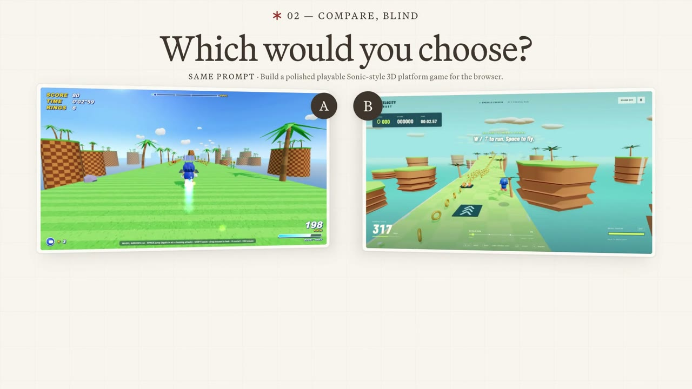
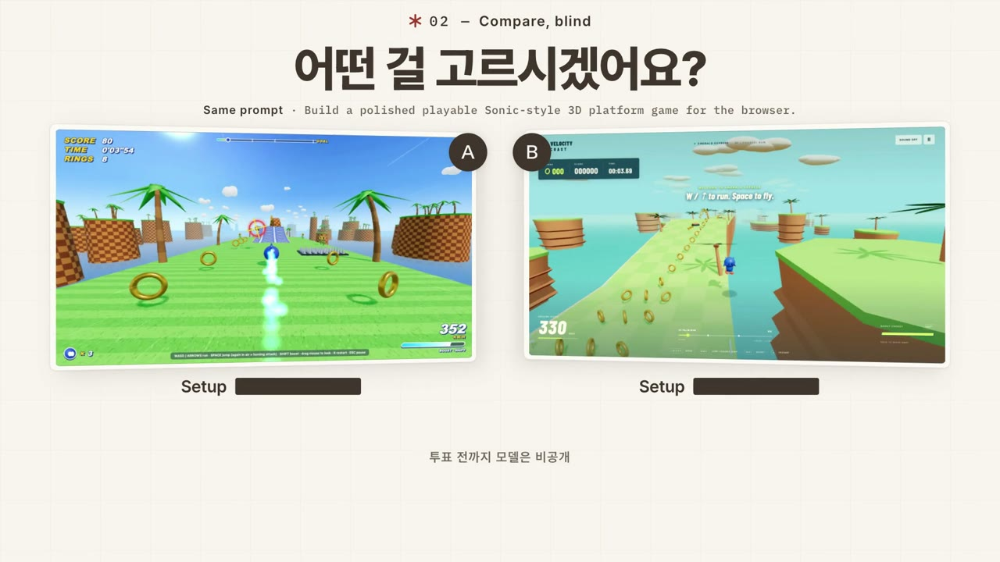

# demo-video-creator

[English](README.md) · **한국어**

제품 URL 하나를 주면 **16:9 런치 필름**을 완성해 주는 에이전트 스킬입니다. 실제 UI 캡처, 실제 결과물 영상, 끊김 없는 나레이션, 비트에 맞춘 모션, 임팩트 효과, 마스터링한 믹스까지 들어간 mp4 한 개가 나옵니다.

같은 스킬로 **영어판과 한국어판**을 모두 만들 수 있습니다. 아래 두 영상이 이 스킬로 만든 결과물입니다.

| English | 한국어 |
|---|---|
| [](media/demo_en.mp4) | [](media/demo_ko.mp4) |
| [▶ Watch `demo_en.mp4`](media/demo_en.mp4) (45초) | [▶ `demo_ko.mp4` 보기](media/demo_ko.mp4) (40초) |

두 영상 모두 [Evals](https://evals.ag) 데모입니다. 스토리와 모션 문법은 같고, 목소리·카피·한글 서체만 바뀝니다.

## 설치

```bash
npx skills add chacha95/demo-video-creator
```

설치한 뒤 에이전트에게 이렇게 요청하면 됩니다.

```text
https://your-product.com 한국어 버전으로 1분짜리 가로 데모 영상 뽑아줘
```

```text
Make a 1-minute landscape demo video for https://your-product.com
```

레퍼런스 영상도 받습니다. "이 영상 느낌으로 우리 제품 영상 만들어줘"라고 하면서 URL이나 파일을 함께 주면 됩니다.

## 결과물

| | |
|---|---|
| 규격 | 1920×1080, 30fps, H.264 + AAC 192k |
| 길이 | 약 40~60초 |
| 음량 | 마스터 −14 LUFS, 나레이션이 음악보다 앞에 들림 |
| 언어 | 영어(ElevenLabs *Will*) 또는 한국어(ElevenLabs *Choi*, Pretendard 서체). 두 버전 모두 제품 UI 용어는 영어 그대로 씁니다. |
| 프로젝트 폴더 | `videos/<이름>/` 아래 `SCRIPT.md`, `DESIGN.md`, `DECISIONS.md`, HyperFrames 빌드, QA 스트립, `renders/<이름>.mp4` |

영상 구성은 항상 같습니다.
1. 3초 훅: 실제 결과물을 나란히 보여 줍니다.
2. 실제 작업 하나를 처음부터 끝까지 따라갑니다. 입력 → 설정 → 실행 → 비교 → 근거 → 리더보드 순서입니다.
3. URL이 들어간 엔드 카드로 끝납니다.

## 준비물

### API 키 (필수)

| 키 | 용도 | 받는 법 |
|---|---|---|
| `ELEVENLABS_API_KEY` | 나레이션(`eleven_v4`, `/with-timestamps`)과 배경음악(ElevenLabs Music) | 1. [elevenlabs.io](https://elevenlabs.io)에 로그인합니다.<br>2. 왼쪽 아래 프로필 → **Developers / API Keys** → **Create API Key**를 누릅니다.<br>3. 권한에서 **Text to Speech**, **Music**, **Voices (read)**를 켭니다.<br>4. 키를 복사합니다. 키는 한 번만 보여 줍니다. |

음악 생성(Music)은 유료 플랜이 필요할 수 있습니다. 영상 한 편에 나레이션 1회와 음악 후보 2~3개를 생성합니다.

에이전트를 실행하는 프로젝트 루트의 `.env` 파일에 키를 넣으세요.

```bash
ELEVENLABS_API_KEY=여기에_키
```

키를 채팅창에 붙여넣지 마세요. `.env`는 git에 올라가지 않게 해 두세요(`echo .env >> .gitignore`). 스킬은 처음 실행할 때 키가 유효한지 API로 확인합니다. 빠진 게 있으면 작업을 시작하기 전에 한 번에 모아서 알려 줍니다.

### 도구

| 도구 | 용도 | 설치 (macOS) |
|---|---|---|
| Node.js 20+ | HyperFrames 렌더, Playwright 캡처 스크립트 | `brew install node` |
| ffmpeg / ffprobe | 리타이밍, 임팩트 효과, 믹스, QA 스트립 | `brew install ffmpeg` |
| Python 3 + numpy | 비트 감지, 모션 QA, 믹스 검사 | `pip3 install numpy` |
| Playwright + Chromium | 4× DPR UI 캡처, 결과물 화면 녹화 | `npm i -D playwright && npx playwright install chromium` |
| HyperFrames | 컴포지션 빌드와 렌더 (자동으로 받아 옴) | `npx --yes hyperframes@0.8.101` |
| whisper.cpp *(선택)* | 최종 믹스를 로컬 Whisper로 검사 (키 필요 없음) | `brew install whisper-cpp` |
| yt-dlp *(선택)* | 레퍼런스 영상 다운로드 | `brew install yt-dlp` |

Claude Code 기준으로 작성한 스킬입니다. `hyperframes-core` 스킬이 설치돼 있으면 그것도 함께 참고합니다(`npx skills add heygen-com/hyperframes`).

### 제품 쪽 조건

- **Playwright로 열 수 있는 실제 URL이 있어야 합니다.** 화면에 나오는 UI는 전부 실제 캡처이고, 목업은 쓰지 않습니다. 로그인이 필요한 페이지는 로그인된 Chrome을 쓰거나 공개 페이지로 대신합니다.
- **움직이는 결과물이 있어야 합니다.** 게임, 영상, 3D 씬, 인터랙티브 페이지 같은 것들입니다. 정적인 웹사이트 스크린샷은 일부러 쓰지 않습니다.
- **실제 숫자만 씁니다.** 화면에 나오는 모델명, 수치, 기능은 모두 캡처에 실제로 있는 것이어야 합니다.

## 영어판 vs 한국어판

| | 영어 | 한국어 |
|---|---|---|
| 보이스 | Will `bIHbv24MWmeRgasZH58o` | Choi `ZNSVYmudV9pOqphY0x8C` |
| 설정 | `eleven_v4`, stability 0.15, similarity 0.8, style 0.8, speed ≈1.1, 감정 태그 인라인 | 동일 |
| 대본 | 60초 기준 165~180단어 | 같은 속도의 한국어 카피 |
| 서체 | 디자인 시스템의 산세리프 | 한글은 전부 Pretendard |
| UI 용어 | 사이트 표기 그대로 | 영어 그대로 유지 (Task, Setup, Battle, Model, Skill…) |

두 버전을 모두 요청하면 같은 편집으로 렌더한 파일 두 개가 나옵니다.

## 작동 방식

```
브리프 → 레퍼런스 SPEC → SCRIPT.md → DESIGN.md → 실제 UI·결과물 캡처
→ 나레이션 원테이크 → 음악 → HyperFrames 빌드 (나레이션 주도, 비트 고정)
→ fps 재렌더로 배속 → 후반 (임팩트 효과, 믹스) → QA → renders/<이름>.mp4
```

핵심은 세 가지입니다.
- **모션은 형용사가 아니라 측정한 수치로 맞춥니다.** 카메라는 하나, 이징은 두 종류(snappy, floaty)만 씁니다. 나가는 동작의 속도를 다음 샷이 이어받고, 컷은 비트 ±1프레임에 맞춥니다. 자세한 규칙은 [`MOTION_RULES.md`](skills/demo-video-creator/references/MOTION_RULES.md)에 있습니다.
- **나레이션은 한 번에 통으로 녹음합니다.** 자르거나 늘이지 않습니다. 화면 글자는 목소리보다 0.05~0.20초 먼저 뜹니다.
- **납품 전에 QA를 합니다.** 모션 분석, 전환마다 16프레임 스트립, 대사 줄마다 싱크 표, 샷마다 가장자리·모서리 마감 점검을 거칩니다.

전체 파이프라인은 [`SKILL.md`](skills/demo-video-creator/SKILL.md)에 있습니다.

## 제약

- 가로 영상만 만듭니다. 9:16 쇼츠·릴스는 세로 전용 스킬을 쓰세요.
- 영상 한 편을 만드는 데 에이전트 세션이 길게 돕니다. 캡처, 렌더, 후반 작업, QA를 모두 거치기 때문입니다.
- 브랜드 로고와 결과물 영상의 권리는 각 소유자에게 있습니다. 보여 줄 권리가 있는 소재만 쓰세요.

## 라이선스

MIT
